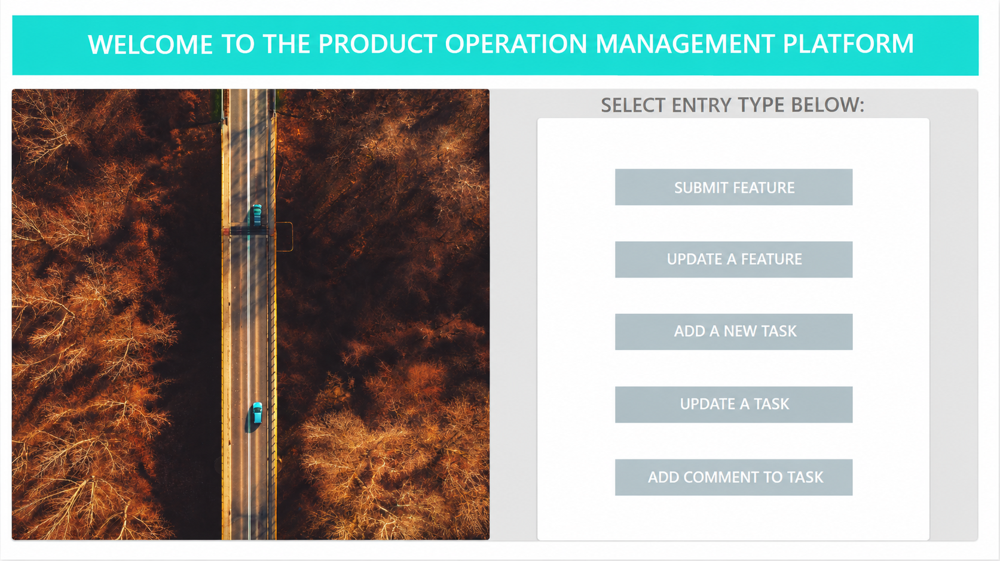
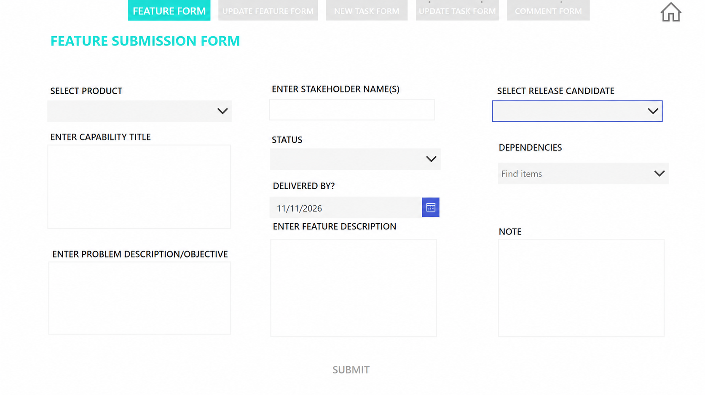
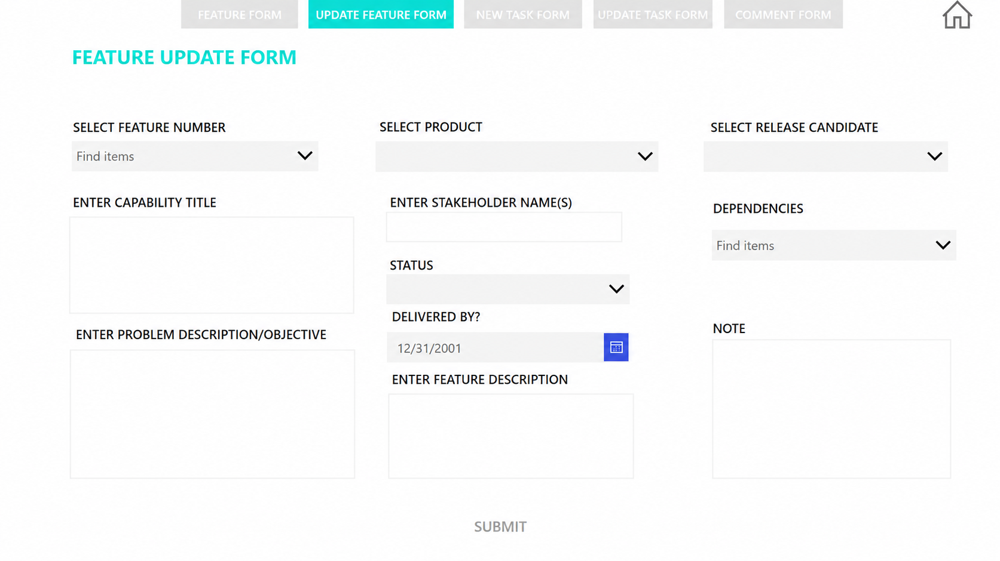
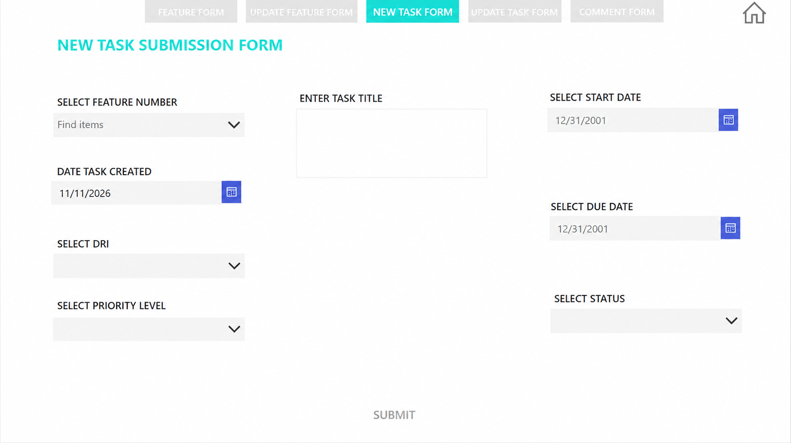
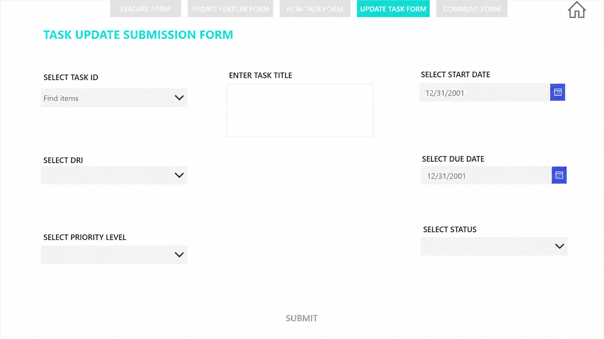
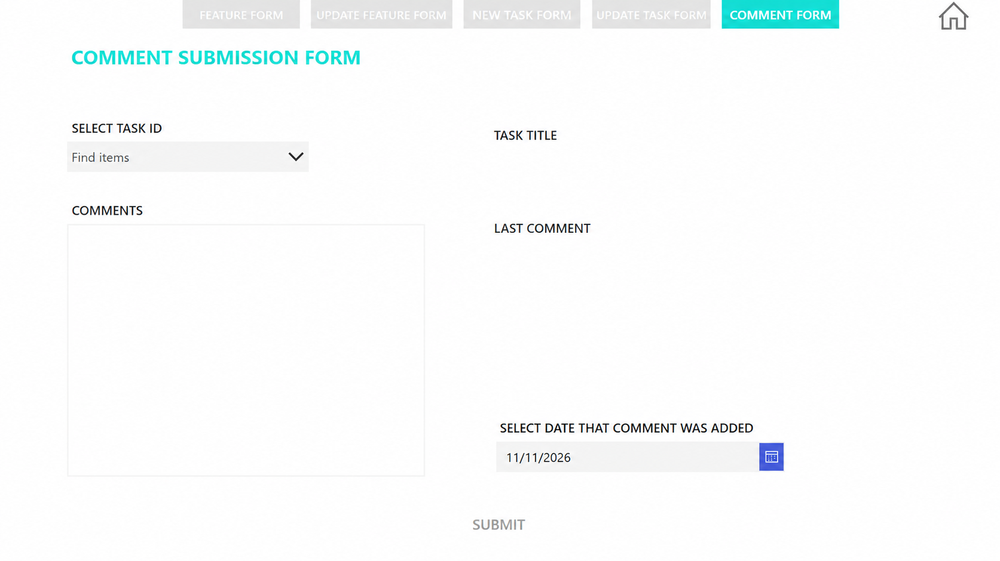

# Product Operations Management Platform

**Microsoft Power Apps · Power Automate · Power BI · SharePoint**

A low-code product operations solution designed to centralize feature planning, task ownership, dependencies, delivery milestones, progress updates and portfolio reporting.

> **Portfolio note:** This repository presents a sanitized representation of a business solution. Organizational data, proprietary information, production connections, internal URLs, credentials and identifying details are not included.

---

## The Challenge

Product planning and delivery information can become fragmented across spreadsheets, email, meetings and individual team processes.

This makes it difficult to consistently track:

- Product features and capabilities
- Business objectives
- Stakeholders
- Ownership
- Dependencies
- Delivery dates
- Task priorities
- Status and progress
- Comments and updates

The solution was designed to create a more structured and scalable operating model for managing this information.

---

## The Solution

I designed and built a Microsoft Power Platform application that provides a centralized interface for managing the lifecycle from feature intake through task execution, progress updates and collaboration.

The solution standardizes how product and delivery information is captured, maintained and used for downstream workflow automation and management reporting.

---

## Core Capabilities

### Feature Management

- Create and update product features
- Capture business problems and objectives
- Record stakeholders and feature descriptions
- Track delivery dates and status
- Manage dependencies and release cycles

### Task Management

- Create tasks associated with specific features
- Assign accountable owners
- Define priority, start dates and due dates
- Track delivery status
- Update tasks throughout the delivery lifecycle

### Collaboration

- Capture task-level comments
- Preserve progress updates
- Associate comments with individual tasks
- Track update dates

### Reporting & Automation

- Structured data capture for downstream reporting
- Workflow automation and notifications through Power Automate
- Portfolio visibility through Power BI
- Standardized operational processes across teams

---

## Solution Architecture

The solution connects application experience, operational data, workflow automation and management reporting.

```text
Power Apps
    ↓
SharePoint
    ↓
Power Automate
   ↙       ↘
Workflow   Notifications
    ↓
Power BI
    ↓
Portfolio & Management Reporting


Additional architecture documentation is available in the architecture/ folder.

Application Experience

The application provides dedicated experiences for each stage of the product-delivery lifecycle.

1. Product Operations Home

Central navigation provides access to the application's primary functions, including feature creation, feature maintenance, task creation, task updates and comments.

Once the sanitized screenshot is uploaded:



2. Feature Submission

A structured feature-intake experience captures:

Product or workstream
Capability title
Business problem or objective
Stakeholders
Feature description
Dependencies
Release information
Delivery date
Status
Supporting notes



3. Feature Management

Existing features can be reviewed and updated as delivery requirements evolve.

The experience supports ongoing maintenance of:

Product information
Business objectives
Stakeholders
Dependencies
Release information
Delivery dates
Feature descriptions
Status


4. Task Creation

Delivery tasks are associated with specific product features and include structured fields for:

Task title
Feature relationship
Accountable owner
Creation date
Start date
Due date
Priority
Status



5. Task Management

Existing tasks can be maintained throughout the delivery lifecycle, allowing ownership, priority, dates and status to remain current as work progresses.



6. Collaboration & Comments

Task-level comments provide a structured way to capture progress updates and retain previous comments for operational visibility.



My Role

I designed and built the solution across the application lifecycle, including:

Requirements gathering
Process mapping
Application architecture
Data structure design
User experience design
Microsoft Power Apps development
Power Fx business logic
Workflow design
Microsoft Power Automate integration
Operational governance
Reporting requirements
Testing and validation
User documentation

The solution required translating business and operational requirements into a structured digital operating model rather than simply digitizing individual forms.

Technology Stack
Area	Technology
Application	Microsoft Power Apps
Automation	Microsoft Power Automate
Operational Data	Microsoft SharePoint
Analytics	Microsoft Power BI
Business Logic	Power Fx
Reporting Logic	DAX / Power Query
Collaboration	Microsoft Teams
Design Approach

The solution was designed around several principles:

Structured Data Capture

Standardized forms improve the consistency and quality of information captured across the product lifecycle.

Connected Work

Features, tasks, ownership, delivery dates and progress updates are managed as related operational information rather than disconnected records.

Workflow Automation

Structured application data creates the foundation for automated workflows, notifications and follow-up processes.

Operational Visibility

The data model supports downstream reporting and provides greater visibility into delivery progress, ownership, dependencies and portfolio performance.

Scalability

Standardized processes and data structures reduce reliance on manual tracking and provide a foundation that can evolve as product operations grow.

Key Outcomes

The solution established a structured framework for:

Improving visibility across product delivery
Standardizing feature and task management
Strengthening ownership and accountability
Reducing manual follow-up
Supporting workflow automation
Creating structured data for management reporting
Improving consistency across operational processes
Building a scalable foundation for portfolio growth
Sample Data

Any example data included in this repository is fictional and created exclusively for portfolio demonstration.

Additional information is available in the sample-data/ folder.

Portfolio Disclaimer

This repository is a sanitized case study demonstrating solution architecture, application design and technical capabilities.

Company-confidential information, production data, credentials, connection details, internal URLs, proprietary business logic and identifying information are not included.

Sample names, values and scenarios are fictional and provided exclusively for portfolio demonstration purposes.

The original production application and its .msapp package are not distributed through this repository.

About the Builder

Nichola Eberechi Ekeanyanwu

Digital Transformation · Automation · Business Systems · Business Intelligence · Product Operations

I design practical digital solutions that connect business requirements, data, process design, automation and reporting.

LinkedIn: Nichola Eberechi Ekeanyanwu
GitHub: EberechiE
Email: nichola.eke@gmail.com
